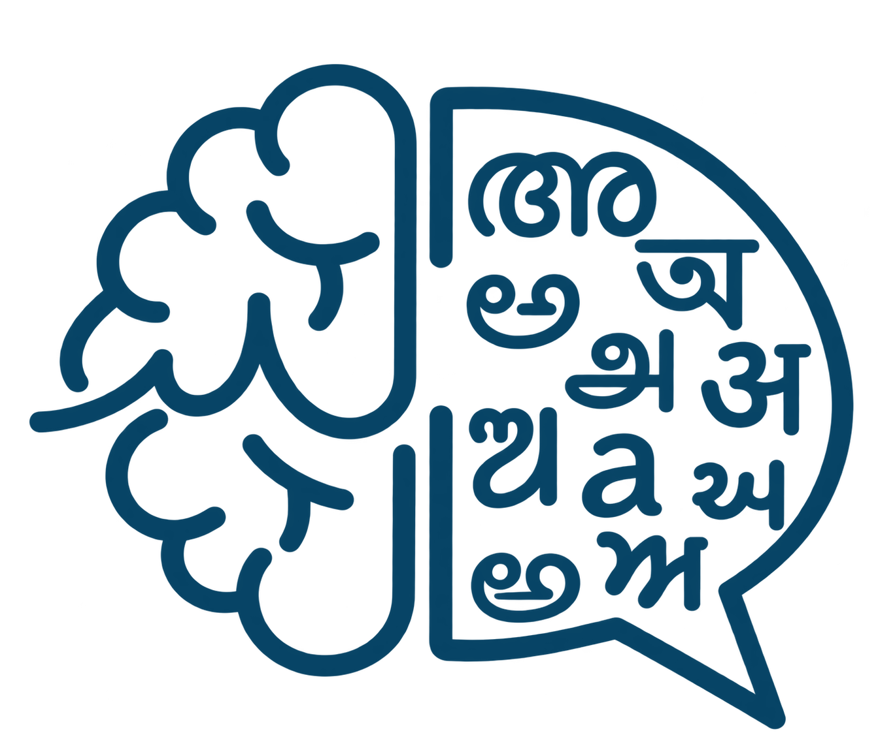

<div align="center">

<picture>
  <source media="(prefers-color-scheme: dark)" srcset="public/lightLogo.png">
  
</picture>

# Language & Cognition Laboratory

**Official website of the Language & Cognition Lab, Department of Humanities and Social Sciences, IIT Madras**

[](https://nextjs.org/)
[](https://react.dev/)
[](https://www.typescriptlang.org/)
[](https://tailwindcss.com/)

[Live site](https://home.iitm.ac.in/anindita/lclab/) · [Report an issue](../../issues)

</div>

---

## About

The Language & Cognition Lab studies the interface of **language, cognition and communication**, with a focus on Indian languages and a cross-linguistic perspective. Its work combines:

- Experimental methods such as eye-tracking and self-paced reading
- Computational tools for linguistic analysis
- Theory, corpus and experimental approaches to multilingual India

This repository holds the lab's public website: its research, people, collaborations, facilities and events.

## Site map

| Page | What it shows |
| --- | --- |
| **Home** | Lab overview, focus areas, facility slideshow and key numbers |
| **Research** | Projects, publications and conferences |
| **Team** | Principal Investigator, researchers, interns, collaborators and alumni |
| **Facilities** | Equipment and experimental setups |
| **Events** | Seminars, workshops and symposia, with upcoming events flagged |
| **Collaborations** | Partner institutions and international collaborators |
| **Contact** and **Fund Us** | How to get in touch and support the lab |

## Features

- **Deep links to people and events.** Add a hash to the URL to jump straight to a card, for example `/lclab/team/#firstnamelastname` or `/lclab/events/#essentialsofgenerativegrammar`. The hash is the name or event title in lowercase letters and digits only. Unknown hashes are ignored.
- **Accessibility.** Dyslexia-friendly font mode, semantic markup and keyboard-focus styles.
- **Responsive design.** Layouts tuned for phones, tablets and desktops.
- **SEO.** Page metadata, Open Graph images, JSON-LD, sitemap and `robots.txt`.
- **Static export.** Builds to plain HTML, CSS and JS for institute hosting.

## Tech stack

- [Next.js](https://nextjs.org/) (App Router, static export)
- [React](https://react.dev/) and [TypeScript](https://www.typescriptlang.org/)
- [Tailwind CSS](https://tailwindcss.com/) with [Radix UI](https://www.radix-ui.com/) primitives
- [Lucide](https://lucide.dev/) icons

## Getting started

Requires Node.js 18.18 or later.

```bash
# install dependencies
npm install

# start the dev server
npm run dev
```

Open <http://localhost:3000/anindita/lclab/>. The site is served under the `/anindita` base path, so `http://localhost:3000/` on its own will not show the pages.

### Scripts

| Command | Purpose |
| --- | --- |
| `npm run dev` | Start the development server |
| `npm run build` | Create the static export in `out/` |
| `npm run start` | Serve a production build |
| `npm run lint` | Run the linter |

## Project structure

```text
app/
  lclab/            Route for each page (research, team, events, ...)
  layout.tsx        Root layout, fonts and metadata
components/
  grids/            Team, intern and Principal Investigator cards
  ui/               Shared UI primitives
  *-section.tsx     Page sections
lib/                All site content as typed data (see below)
public/             Images, logos, web manifest and llms.txt
```

## Updating content

Almost all content lives in typed files in [`lib/`](lib), so most updates need no component changes.

| To change... | Edit |
| --- | --- |
| People, interns, alumni, collaboration members | [`lib/teamData.ts`](lib/teamData.ts) |
| International collaborators | [`lib/collaboratorsData.ts`](lib/collaboratorsData.ts) |
| Partner institutions | [`lib/partners.ts`](lib/partners.ts) |
| Events | [`lib/eventData.ts`](lib/eventData.ts) |
| Publications, projects, conferences | [`lib/researchData.ts`](lib/researchData.ts) |
| News | [`lib/newsData.ts`](lib/newsData.ts) |

Notes:

- **Photos.** Put images in `public/` and reference them as `/anindita/<folder>/<file>`. A person or collaborator without a photo automatically gets an initials avatar.
- **Clickable people.** Set the optional `link` on a person in `teamData.ts` to make their card open that page in a new tab. Without a link the card is not clickable.
- **Collaborators** are sorted alphabetically by first name, ignoring "Prof." and "Dr.".
- **Events.** A date in the future makes the event show an "Upcoming" badge. Use the `notes` list for deadlines or sponsor acknowledgements.
- **Quotes in text.** Escape double quotes inside a double-quoted string (`\"like this\"`), or the file will not compile.

## Deployment

The site is a static export served from the `/anindita` path:

```bash
npm run build
```

Upload the contents of `out/` to the hosting location. To serve from a different path, change `basePath` and `assetPrefix` in [`next.config.mjs`](next.config.mjs), and update the `/anindita/...` image paths in the data files to match.

## Contact

Language & Cognition Laboratory, Department of Humanities and Social Sciences, Indian Institute of Technology Madras, Chennai.
See the [Contact page](https://home.iitm.ac.in/anindita/lclab/contact/) for email and address.

---

<div align="center">
<sub>© Language & Cognition Laboratory, IIT Madras</sub>
</div>
